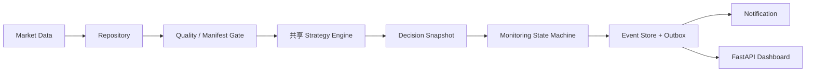

# 监控架构

当前终态更新（2026-10-06）：隔离观察 outputs/持续公开更新24小时_20261005_02 已实际结束，原生exit1、FAILED，累计86406秒；BTC/ETH×D1/H4共656成功、8失败、2中断，各目标164成功，未达到250要求。Windows休眠对应约10小时14分钟扫描间隔，600秒门禁native2拒绝；恢复版本中BTC/ETH各2根H4未被成功扫描，共4项标的bar。原会话及五个已记录工作/子进程均已结束，未完成任务0，不再声明当前仍live。停机后独立Repository Catalog核验native0：660数据记录、4个current有效，1336隔离行情文件及current/运行记录前后不变；1457个原行情文件保护验证通过。隔离目录更新产生的新对象属于正常更新范围，不能把它与原行情保护混淆。本机10个唯一投递、重复0、可投递队列0，不代表用户实际收到提醒。终态证据绑定见 outputs/当前长观察终态验收证据基线_20261006.json；目录一致性通过不改变观察失败。主源码和99原测试仍与先前1388通过基线一致，本轮未重复全量回归。正式全资产行情、实际用户通知和长期连续运行仍未完成，整体目标未完成；下文旧检查点保留为历史证据。

当前运行状态更正（2026-10-06）：本机Windows系统日志记录北京时间01:57进入低功耗、12:08恢复，与约10小时14分钟扫描启动间隔相符；系统报告Button or Lid，唤醒来源未知。原观察会话62340仍可实际轮询，监督器自动更换扫描子进程并将2项遗留任务标为INTERRUPTED，随后四目标扫描恢复。检查点累计480成功、8失败、2中断，未完成0；62份决策、45份事件封装可验证，本机接收器10个唯一事件、重复0。扫描间隔600秒门禁以原生退出码2拒绝，不能宣称连续运行或24小时验收通过。恢复后的BTC/ETH×D1/H4四份固定快照完整复现一致，重复成功扫描复用决策；执行门禁均关闭。证据见 outputs/长间隔主机电源事件_20261006.json、outputs/长间隔扫描门禁原生退出回执_20261006.json、outputs/长间隔恢复四目标精确复现_20261006/精确复现回执.json 和 outputs/长间隔恢复与重复扫描去重回执_20261006.json。没有更改系统电源设置或核心策略；此前完整1388项通过属于历史基线。正式股票/ETF/贵金属数据、真实用户通知和长期运行验收仍未完成，整体目标未完成。下文保留的较早检查点均为历史证据。

运行现状更正（2026-10-05 19:55北京时间检查点）：下文按日期保留的“仍在运行”描述是历史检查点，不代表当前存活。旧观察句柄62303、71138及68098均已结束或丢失；旧62303/68098的进程消失及原行情保护证据见 `outputs/双观察进程消失取证回执_20261005.json`，消失根因未证实，不将历史RUNNING字段作为存活证明。当前隔离公开更新观察位于 `outputs/持续公开更新24小时_20261005_02`，本轮实际轮询句柄62340，并由Windows原生检查确认两个持有子进程存活；这只证明检查时存活。

当前只读审计见 `outputs/公开更新中断恢复现状审计_20261005.json`：状态样本运行14184秒，BTC/ETH×D1/H4累计184成功、8失败，各目标46成功、2失败，未完成任务0；36份决策、32份事件封装可验证；4次通知投递对应本机接收器4个唯一事件、重复0。8次失败来自两轮公开Binance TLS连接异常，后续恢复；外部网络根因未证实，故障与恢复去重证据见 `outputs/中断恢复供应商故障后三轮扫描去重回执_20261005.json`。1457个原行情文件保持不变。H4两目标各推进1根已收盘bar，D1尚未推进。相邻已记录任务最大启动间隔303.603671秒，600秒审计门禁通过；这不是连续进程存活证明，也不是正式产品SLA。

主264源码及99份测试源码仍与 `outputs/组合修复正式交付基线_20261004.json` 一致；1388通过、7项既有警告为此前实际完成的完整回归，本轮未重新运行。P0-core的Final仅限已验证本机Windows/后端合同。24小时与各目标250成功轮、全部周期新收盘推进、股票/ETF/贵金属正式数据、实际用户通知渠道和整体监控交付仍未完成；活跃更新目录的最终Catalog审计须待持有工作进程停止后进行。本轮没有改变策略、质量门禁或运行器，也没有新开观察代替当前进程。

真实v3双周期历史回放复核（2026-10-04）：本轮无必要结构性修改，主264源码和99份测试源码仍与8fe0b1.../1388项完整通过基线一致。在已结束的v3公开行情短验收数据上，使用既有HistoricalReplay和共享Backtest运行BTC/ETH×D1/H4四个固定版本，实际终止exit0；日线各400根、H4各543根，共1886根逐bar回放，四组各自均覆盖IDLE/SETUP/CANDIDATE/CONFIRMED_ENTRY/POSITION/EXIT。同bar、同捕获模拟组合与资金输入的1882根策略意图比较差异0；每组末根因Backtest没有对应入场评估而未比较，共4根，不伪造其输入。四个独立回放库通知outbox/attempt均0，38行情文件、Catalog current及原实时事件/任务计数不变。这是策略意图与模拟账户上下文一致性证明，不是成交/PnL、实际持仓或整个监控验收。长观察62303/71138仍在运行，24小时、新收盘bar、其他资产正式数据和用户通知仍待完成。证据outputs/v3真实历史回放交付基线_20261004.json。

持续更新审计复核（2026-10-04）：旧长观察复核工具在已成功完成的v3更新短验收上复现exit1，根因为把隔离行情正常变化当作只读违规；本轮只扩展审计工具，不改运行器或核心源码8fe0b1...，264源码及99份原测试源码与1388项完整通过基线一致。更新模式现在核验原行情哈希、运行库根绑定/隔离、所有快照模型与哈希、成功任务的质量/新鲜度和未知账户执行门禁、通知回执，保留默认只读检查。14项合同通过，覆盖原4项及新10项允许隔离更新、拒绝原行情变动/假成功/根冲突；实际运行中的4目标首检查点8成功、166目标检查点3轮498任务和330唯一本机投递，未完成任务均0。另外通过现有scanner.reproduce精确重算已结束v3短验收的四份真实市场快照，完整payload逐字段相等，38行情文件、Catalog current及原事件/任务计数不变，独立复现库无事件或通知。隔离数据的最终Catalog仍由运行器在持有工作进程停止后核验，不把活跃更新中的跨连接观察冒充原子Catalog审计。长观察62303/71138仍live，未完成24小时或新收盘bar验收，实际用户通知和其他资产正式数据仍待完成。证据outputs/持续更新审计交付基线_20261004.json。

持续公开更新复核（2026-10-04）：主源码8fe0b1...完整1388项回归通过；本轮仅扩展验收工具，未变更核心策略/数据门禁。首次公开更新短观察使用裸根，实际选择legacy DuckDB，11成功/1次Catalog文件占用失败，阻断并恢复；不能作为稳定性通过。核实此前裸根真实行情短验收同样属于legacy后端范围，旧记录称其v3的表述应以此更正为准，不用其代替v3持续更新证据。工具已显式初始化v3 SQLite；一次初始化网络超时现场保留，并补齐初始化FAILED回执、原数据保护和不启动监督进程的合同。最新12项工具合同通过（独立于1388主回归）；实际v3短验收exit0，BTC/ETH×D1/H4各3轮，共12成功/0失败，Catalog与未知账户门禁核验、进程退出和原行情保护通过。短观察未跨新收盘bar，也没有市场事件通知，因此不证明长期更新或用户收到提醒。全83资产×2周期只读24小时观察62303，以及BTC/ETH真实更新24小时观察71138均已启动并确认live；后者要求每目标250成功轮数及至少1次新收盘bar推进。两者尚未完成24小时验收，其他资产正式数据和实际用户通知目的地仍待完成。证据outputs/持续公开更新验证基线_20261004.json。

主工作区完整回归复核（2026-10-04）：62824已实际结束exit0，1388 passed、7项既有警告、575.58秒，0失败/错误/跳过。主源码8fe0b1...与已完整通过的三文件候选逐字节一致，原95份测试源码保持不变、新增4份测试源码。证据outputs/组合修复正式交付基线_20261004.json绑定264源码/pyproject、99份测试源码、完整报告及依赖。P0-core在已验证的本机Windows/后端合同范围维持Final，不代表全资产数据认证或整个监控系统Final。持续验收工具保留默认只读模式，新增明确选择BTC/ETH的隔离公开更新模式，保护原数据并要求成功更新轮数和可配置收盘bar推进数；9项隔离合同通过，真实短验收待终态。

合入后真实输入复核（2026-10-04）：新隔离目录outputs/组合修复真实更新验收_20261004_01的公开Binance真实更新验收已终止exit0；BTC/ETH×D1/H4三轮12项SUCCESS，四份快照精确复现，同版本决策去重、重新打开运行库及Catalog/SQLite核验通过，未完成0、重复事件0。unknown账户execution=false，无订单或外部通知；本次仍是短验收，不能证明长期稳定。主完整回归62824仍待终态。证据outputs/组合修复本轮基线_20261004.json。

组合修复集成复核（2026-10-04）：组合候选完整回归已实际结束，1388 passed、7项既有警告、552.55秒，退出码0，外部源码/测试模块均0。三处补丁已逐文件校验后合入主源码8fe0b1a7f2735a68ecb41c47971a34c8e431e945235a26c37c512016c488a2e6：Dukascopy环境凭据显式开关、factory传递公开凭据策略、Windows停止Win5边界要求受限等待并取得真实句柄退出证明。真实拒绝访问或等待超时仍抛原异常，无质量门禁降级。原95份测试源码字节不变，新增4份共19个案例；集成前递归清单计数检查曾中止，未发生写入，修正清单校验后成功。主完整集成回归62824已启动，尚未取得终态，不能用候选通过替代主回归。集成回执outputs/组合修复集成_20261004/集成回执.json。旧只读观察89379已实际终止exit1，源码守卫触发FAILED，累计4151.17秒、166目标各14轮、2324任务（2296失败/28成功）、330唯一本机投递；1457行情文件不变、未完成任务0、持有进程已确认退出，停止回执outputs/组合修复旧观察停止回执_20261004.json。旧观察不是24小时通过，也不是provider持续更新验证。主回归通过后再开展新源码持续验证；股票/ETF与贵金属正式行情、实际用户通知目的地及多天运行仍未完成，整体未Final。

原生停止边界新复核（2026-10-04）：修正启动器后的64629 terminal exit1，1381 passed/1 failed、7警告、560.30秒，源码/测试模块均来自候选。失败为v3原生卡死恢复合同退出时TerminateProcess Win5；单独三个后端重跑通过，不当作全量通过。受控内核交错和真实Job/句柄/Win5加一次延迟poll观察均复现旧停止路径；新组合候选8fe0b1...在错误5时最多等待5秒并要求句柄退出，真实拒绝访问/超时继续抛原错误，44项监督合同及真实交错1项通过。原失败现场没有记录完整内核时间序列，不能断言与受控交错完全同一时序。组合完整回归26863本轮live，尚未合入主253e61...；89379原只读观察继续。证据outputs/凭据与原生停止候选基线_20261004.json。

候选完整回归复核（2026-10-04）：67830已terminal exit1，1378 passed/1 failed/7警告，551.17秒。失败来自候选测试启动器缺少Windows spawn主入口保护，子进程重新执行相对目录解析，尚未进入通知HTTP恢复函数。修正启动器，不改候选核心或原测试，32项通知恢复/凭据/实际监控入口合同通过，外部源码与测试模块均0；候选源仍c501669...。新完整回归64629本轮确认live，尚未通过/集成。候选读取前轮实际Binance正式数据的四项扫描及复现通过，38个所选行情文件不变，unknown执行门禁false；不是更新验收。证据outputs/公开凭据父子入口验证基线_20261004.json；主253e61...与只读观察89379保留，整体未Final。

公开凭据边界新复核（2026-10-04）：主源码253e61...中create_default_providers(credential_providers=False)仅关闭Alpha注册，Dukascopy仍读取DUKASCOPY_API_KEY并附于目录/历史请求。虚拟值、禁止实际网络的合同复现1失败；未读取或发送实际密钥。隔离候选公开行情凭据隔离候选_20261004将该策略传给Dukascopy环境凭据开关，默认旧入口保持兼容，55项针对回归通过、外部inv_trend模块0。候选c501669...全量回归会话67830本轮live，尚未合入主源码。主只读观察89379仍live且refresh=false，不能证明这一公开更新边界已修复。实际无key目录请求收到HTTP429，贵金属正式数据仍未准备好；不能推断必须注册或提供密钥。

真实运行链补充（2026-10-04）：新隔离根outputs/真实更新运行链验收_20261004_03经公开Binance初始化，由既有build_scanner(refresh=true)与MonitoringRuntime执行BTC/ETH×D1/H4三轮，共12项SUCCESS。第二个runtime/scanner重新打开同一事件库后继续扫描，同版本输入复用原decision_id，四份快照可复现；Catalog及SQLite完整性通过，未完成0、重复事件0、市场事件0，unknown账户execution=false。证据绑定outputs/真实更新运行链交付基线_20261004.json；不代表OS崩溃、跨下一收盘边界或长期provider稳定。原data未更新，整体未Final。

最新工作区基线（2026-10-04）：完整1369 passed、7项既有警告、536.30秒，无失败/错误/跳过，源码253e61d97fa82f2bc2449b261fecf049d4316d5a968db6d37569bf294a90cb8f。outputs/生命周期集成交付基线_20261004.json绑定264源码/pyproject、测试源、报告及依赖；P0的244项清单只有data/api.py变化，新增身份门禁合同和全部原封版/恢复合同通过，恢复本机Windows/后端验证范围P0 Final。整体监控仍未Final。

实际数据链路新增证据：BTC/ETH D1各400根、H4各540根经既有Binance公开接口进入全新隔离v3根，四项正式读取/coverage/freshness通过；实际增量更新在内容不变时复用D1版本，H4推进至2026-10-04 08:00UTC。共享MonitorScanner四项quality/freshness均true、未知账户execution=false，重复扫描返回同一快照且不新增事件。四份真实快照无写入精确复现，真实BTC D1 400根回放覆盖六状态，共享回测399根策略意图差异0，末根未比较，不是执行/PnL验证。见outputs/实际加密链路交付基线_20261004.json；未改原data，不能据四项证明全部资产已准备好或持续更新已通过。

新源码24小时只读观察已启动于outputs/持续监控24小时_20261004_02，仍RUNNING，会话89379；全部83 ACTIVE×D1/H4共166目标，使用原Repository行情、新独立事件库和本机通知接收器。它仍为refresh=false，不代表真实provider持续更新。首检查点166目标各1轮、166任务、未完成0、166唯一投递且重复0、1457行情/current不变，暂无HEARTBEAT_MISSING；短检查点不是24小时通过。

2026-10-04生命周期与修复集成：CSV行身份冲突、心跳读后观察时刻及预期组件生命周期已合入主源码253e61d97fa82f2bc2449b261fecf049d4316d5a968db6d37569bf294a90cb8f。生命周期保留原expectation/心跳及版本化审计，显式退役使用epoch CAS、actor/reason，拒绝活着/未知持有者或未完成扫描，重新登记产生新epoch并要求新心跳；审计缺失或不一致拒绝启动。watchdog不从历史心跳恢复退役目标，CLI防止退役配置仍启用的目标。组合候选214项通过，主工作区完整回归执行中，尚不恢复P0 Final。原24小时观察因这次有证据的修复集成触发源码守卫，最终FAILED、5952.86秒，不冒称长期通过；停止回执证明未完成任务0及本次进程全部退出，原行情不变。需新的持续验证。

2026-10-04新增P0阻断：outputs/授权CSV身份冲突复现_20261004_02/复现回执.json使用真实CSV、公开ingest及v3正式读取，复现显式ETHUSDT源代码/H4周期被请求BTC/D1覆盖并作为CURATED读取。原1330回归未覆盖此输入合同，不能继续无条件宣称当前P0整体Final。outputs/CSV身份修复候选_20261004在清洗前验证显式行身份，尚未合入主源码；原24小时观察继续冻结。另有outputs/预期组件退役复现_20261004/复现回执.json证明移除配置目标不能退役持久expectation，watchdog重新启动仍告警；需显式、可审计生命周期，不能自动删历史心跳隐藏故障。

2026-10-04原始快照隔离接入：76份股票原始输入经公开HistoricalDataService.ingest进入全新v3根，76条dataset/current通过完整Catalog制品、哈希和指针检查。原research_only=true及全部供应商元数据/请求/身份保持一致，76次正式读取全部拒绝；缺口改善不能解除来源用途限制。见outputs/股票原始快照重新认证_20261004_01/研究限制与正式门禁回执.json及重放元数据一致性.json。原行情/current不变，无网络更新或新鲜度认证。最新长观察166目标各至少14轮、2324任务、333本机唯一投递，仍RUNNING；心跳缺失累计3项，修复候选尚未合入，整体未Final。

活动长观察只读审计：独立scripts/长观察复核.py使用只读SQLite事务及既有Snapshot/Envelope验证，不修改运行时或重新解释策略。当前已观察166目标至少3轮、498任务、330本机投递且无重复键，第三轮新增164条连续失败状态告警；数据健康166条保持不变。源码f096a814...及原核心测试均未变，4项新增审计工具合同独立通过；见outputs/长观察检查交付基线_20261004.json。24小时仍RUNNING，不以检查点代替最终持续验收。

最新通知监督事务回归（2026-10-04）：39项相关合同和全项目1330项通过、7项既有弃用警告、565.04秒，无失败/错误/跳过；源码f096a81489da15ec6abe1d7a2ef28e67e38ce354fcaa33afb40d44f238ae927e，见outputs/通知监督事务交付基线_20261004.json。264个源码/pyproject绑定报告、测试源和配置，P0的244项文件无变化，维持本机范围Final。启动记录与监督范围现为同一事务。通知监督本机故障合同已验证，整体监控仍未Final：实际目的地、长时间无人值守、预期目标退役与正式行情准备度仍缺。

持续验收工具scripts/持续监控验收.py使用真实Repository只读行情、独立事件库、两个既有监督器及本机HTTP接收器，周期性读取看板。它绑定源码及自身哈希、保存行情CSV/Parquet/current指针哈希，要求最少完整扫描次数，停机后检查任务终态和自己启动的进程。短试跑不证明长期稳定，refresh=false不证明provider持续更新能力；整体状态以实际长观察结果为准。

通知监督事务追加复核（2026-10-04）：上一版源码96c151...全项目1329项通过、7项既有警告、560.81秒，回执outputs/通知监督交付基线_20261004.json已明确记录范围入库原子性待办。实际SQLite触发器复现1失败：自动提交使第二次范围INSERT失败后留下启动记录。现已在同一BEGIN IMMEDIATE事务写入启动及范围，异常由连接边界回滚并停止持有子进程。当前源码f096a81489da15ec6abe1d7a2ef28e67e38ce354fcaa33afb40d44f238ae927e，追加回归执行中，不能用1329项代替当前源码完整验证。

当前通知监督迭代（2026-10-04）：ProcessSupervisor增加notification范围，复用同一原子启动/停止/预算实现；supervise-notify启动既有notify --serve，匹配渠道和Job成员心跳。扫描与通知锁/历史/预算独立，旧历史按runtime兼容。通知监督事件为NOTIFICATION_HEALTH，空闲等待维持真实心跳及协作停止，不创建行情Repository、Strategy或新的队列实现。相关39/5/76/34项通过，当前全项目回归执行中，源码96c151440567db3c85cedc9faf1b09e302627bfa378809dbfb2425826c4cec31。旧文档通知监督待办为历史记录；实际用户目的地及长期运行仍未完成。

当前原子创建迭代（2026-10-04）：Windows监督创建改用PROC_THREAD_ATTRIBUTE_JOB_LIST，在初始线程运行前完成Job归属；不支持时拒绝创建，不退回先创建再归属。仅继承NUL输入和日志句柄，Job句柄不继承。首轮18项、边界23项、第三轮28项通过；第三轮覆盖原生CreateProcess返回、启动函数返回及启动入库三个父进程kernel退出边界。最终全项目1315项通过、7项既有弃用警告、538.64秒，无失败/错误/跳过；源码105e91d2e0d150260559fed748607d5a28c42df8963220343a46b1da193924f4，264个源码/pyproject与报告、测试源及配置绑定至outputs/原子归属交付基线_20261004.json。P0的244项文件较上一基线无变化，保持本机验证范围Final。旧1307报告为历史证据。通知进程监督、实际通知目的地及长期运行仍未完成。

平台契约依据：[Microsoft UpdateProcThreadAttribute](https://learn.microsoft.com/en-us/windows/win32/api/processthreadsapi/nf-processthreadsapi-updateprocthreadattribute)。JOB_LIST要求Windows 10 / Server 2016及以上；本轮验证仅代表本机Windows环境。

最新进程监督回归（2026-10-04）：全项目1307项通过、7项弃用警告、537.66秒，无失败/错误/跳过；源码24bb99a78a04202faca62af536dabf39c8ecfa4d91bc8806f076b8d93b42665c，见outputs/进程监督交付基线_20261004.json。ProcessSupervisor复用运行记录/HealthRecorder，只持有自己创建的子进程句柄；Windows Job核验实际工作PID并在已归属后清理退出。启动、心跳及扫描硬期限、有限持久重启预算、实例锁和停止标记已实现；三后端原生阻塞恢复及12次后续扫描去重通过。旧心跳超时观察不覆盖更新的工作线程脉冲，未完成任务不受历史分页限制。P0的244项清单无变更，维持本机范围Final；整体仍未Final：启动时原子Job归属、通知进程监督、更长运行和实际通知目的地待验收。

最新Catalog故障回归（2026-10-04）：全项目1291项通过、7项弃用警告、522.57秒，无失败/错误/跳过，源码d585134de292fa0b39d16a14e753fd2c9e5580ce3a6688d73348e57774b20ce7，见outputs/目录故障交付基线_20261004.json。DataLake与UnifiedStore在自己持有的连接边界将真实数据库故障标为CatalogAccessError，保留原异常链与唯一性约束合同；读取、更新及看板统一阻断并显示CATALOG_FAILURE，历史请求范围查询不再吞错。P0原243文件变更4项并新增目录故障依赖至244项，完整回归维持本机范围Final。整体监控仍未Final，进程监督、实际接收目的地及长期运行待验收。

最新长期健康边界回归（2026-10-04）：全项目1264项通过，7项弃用警告，445.03秒，无失败/错误/跳过。源码97df3e9706cd13bcc920755e5ca9b153e16730188ea06c84b8bdbd59a5219f2b，见outputs/长期健康交付基线_20261004.json；P0原243文件较看板基线无变化。RuntimeLedger持久登记预期scheduler/scanner/notification组件，与真实心跳分离；首次宽限与失联、跨重启连续失败和恢复均已有合同验证。看板核对RuntimeMetadata与Repository数据根；未改变共享Strategy或数据质量门禁。整体监控仍未Final：实际用户通知目的地、硬卡死进程监督、长期运行及Catalog异常分类仍需完成。

2026-10-04进度：阶段C2通知交付全项目1217项通过、6项弃用警告，无失败、错误或跳过；包含共享配置修复、独立通知命令、租约/重试/审计、真实HTTP和进程退出恢复。源码c8642fbf647a330a1c1cee705d9c9065f44821e0dff9c8cda6d0a9bebabd8e9e，见outputs/阶段C通知交付基线_20261004.json。此前83资产×D1/H4共166项实际只读扫描完成，1706行情文件与current指针不变，市场事件/确认入场为0；本轮仅处理事件库隔离副本。P0-core在本机和固定依赖范围内保持Final；整体监控尚未达到Final。复现及源码修改见 `监控建设_当前架构与迭代记录.md`，运行入口见 `monitoring_operations.md`，逐项验收见 `monitoring_acceptance.md`。

最新阶段C3看板全项目1245项通过、7项弃用警告，432.39秒，无失败/错误/跳过；源码ac857308a295f8653c74b355866f8f1e42f8cfd6c69274cdec8c818bd1eb2fef，261个源码/pyproject文件与全量报告、精确浏览器视口和截图绑定，见outputs/阶段C看板交付基线_20261004.json。P0原243文件较通知轮仅pyproject.toml和data/api.py变化，全量回归维持本机范围Final，见outputs/P0阶段C看板回归基线_20261004.json。C2回执保留为历史证据。

计划完整链路为：

已实现的数据层包括规范化、版本/Manifest/质量门禁、审批事务、显式Catalog后端、指针校验与恢复。共享海龟引擎和批量回测投影器保留相同突破确认逻辑及完整canonical规则解析。监控层包含模型、状态机、事件存储、策略适配、新鲜度、扫描器和回放；阶段C1增加运行配置、运行时、执行记录、健康及独立CLI。C2增加通知队列与独立消费命令，C3增加FastAPI只读看板；后续增加预期组件、连续失败、Catalog分类及扫描/通知进程监督。用户实际目的地和多天运行仍待验收，局部/全量范围以顶部最新记录为准。

Runtime按instrument_id+timeframe取得数据根共享锁，记录RUNNING任务，正式Repository.update/load以后调用共享策略；退出或软期限超时在事务开始和COMMIT前检查，禁止迟到市场决定。运行任务有终态、决策引用和脱敏错误，事件库内唯一索引阻止未知owner被接管；只有known-dead进程的未完成任务被恢复为INTERRUPTED。v3 CatalogPath在比较数据根时转换为原生Windows物理Path，实际不同根仍拒绝。

HealthRecorder复用快照/事件/outbox事务，健康状态改变时通知，generation区分健康→故障→恢复的重复周期。运行时记录provider、scanner、scheduler、超时及锁冲突；独立watchdog读取心跳，在行情Repository无法启动时也能检查scheduler。已验证但认证失败的报告使用DataCertificationError，仍为DataLineageError子类并阻断正式数据。阶段C2前置增加DataUnavailableError区分没有正式版本的DATA_MISSING；有current而文件丢失属于MANIFEST_FAILURE。实际复核为88缺失、76质量失败和2过期。

notifications/渠道.py定义独立Webhook HTTP接口，禁止重定向、隐式凭据和非有限JSON，使用稳定事件id作为远端幂等键。notifications/队列.py在短事务中认领outbox，提交租约及attempt审计后才执行HTTP；回写要求同一有效lease_token，旧持有者不能覆盖接管后的结果。429/5xx/传输故障指数退避重试，永久错误或预算耗尽保留FAILED；不影响主扫描事务。租约过期后的再次发送保留同一远端幂等键，接收方必须实现去重，不能声称任意Webhook恰好一次。

Notification Envelope从已验证快照与绑定事件投影，包含event_id、dedup_key、snapshot_id、instrument/timeframe、事件类型/名称/严重度、前后状态、时间、数据/策略/配置/代码版本、行情/指标/条件/原因、delivery_status及delivered_at；不发送完整账户上下文。策略状态通知由RuntimeConfig.notifications控制，默认SETUP/IDLE关闭；系统/数据WARNING以上才发送，同渠道NOTIFICATION_HEALTH保留审计但抑制发送以避免故障循环。独立notify命令及watchdog记录/检查通知心跳。真实本地HTTP与进程退出恢复已通过合同验收，用户实际目的地尚未提供。

扫描只调用HistoricalDataService的正式load_bars/load_bars_version接口。Repository返回已验证质量合同，监控再次检查版本/资产/周期绑定、OHLCV、完成性和bar_end；不直接打开CSV/Parquet或自行读取质量文件。未知、过期或不完整账户不能通过执行门禁；多资产账户缺其他持仓当前价格时同样阻断。paper账户是显式模拟参考，observed账户需要观察身份、时间及每个持仓引用。

策略适配调用共享MultiAssetTurtleStrategy的指标准备、突破确认、趋势/ADX/ATR过滤及订单预算逻辑。候选和接近通道仅作为观察，不生成成交。快照保存原始账户输入、完整前置状态、实际价格前缀哈希及策略计算后的参考状态与意图；计算从已冻结的快照账户重建独立对象，既不原地修改输入，也不受观察器中途更新账户影响。快照、账户往返及旧bar顺序比较保留纳秒时间精度。

| 状态 | 含义 |
| --- | --- |
| IDLE | 暂无接近或触发条件 |
| SETUP | 接近策略条件 |
| CANDIDATE | 已触发候选，最终门禁尚未全部通过 |
| CONFIRMED_ENTRY | 收盘、趋势、质量、新鲜度、执行门禁均通过 |
| POSITION | 来自明确持仓记录的观察，有引用和方向 |
| EXIT | 已有明确持仓的策略退出提醒，等待持仓关闭事实 |

SETUP/CANDIDATE允许退回前一状态或IDLE。CONFIRMED_ENTRY不会自动变成POSITION；EXIT也不会自动生成成交。质量失败保留最后已知状态，并由后续健康事件说明当前无法验证。

事件种类为MARKET_SIGNAL、POSITION_EVENT、DATA_HEALTH、SYSTEM_HEALTH、NOTIFICATION_HEALTH。每条事件绑定决策；通知任务绑定事件。单个SQLite事务写入决策、状态、所有独立事件和outbox；市场状态变化不会覆盖同时发生的持仓观察或健康恢复。相同输入重试返回原始回执，状态revision防止并发覆盖，旧bar不能回退状态。数据库有独立所有者标记，拒绝把Market Data或其他已有数据库作为事件库。schema 2引入live/replay用途，schema 3增加投递字段和notification_attempts；已识别的旧库在事务内升级并保留原记录，schema 3缺字段直接拒绝。replay库拒绝live快照和通知任务，HistoricalReplay要求单独的replay库。旧schema 1只在已有决定的mode可验证且一致时迁移，未知/混合用途保留原库并拒绝接纳。

快照schema 3包含instrument_id、symbol、timeframe、bar_time、evaluated_at、dataset_version、strategy_version、config_hash、git_commit、code_hash、OHLCV、关键指标、逐项条件、前后状态、原因、主要event、additional_events、输入context与state_context。additional_events仅接受独立持仓/健康事件，不能旁路正式市场门禁；相同事件不能在单次决定重复。证据深度冻结，未知条件不能被隐式转换为True，NaN/Inf不能持久化；未就绪指标记录null，确认状态即使省略事件也必须通过最终门禁。重复输入去重排除时钟、计算输出与可变状态，但包括数据门禁、账户、配置、源码、instrument配置、质量合同和完整价格前缀。

历史回放固定一个Repository版本，逐bar只给策略已到达该bar的前缀，在bar_end和发布宽限后评价；回放不入通知outbox。可捕获现有回测器每根bar的模拟账户/权益，再比较两边策略意图。这只验证相同计算输入，不宣称真实成交、收益或供应商当时可得性一致。已保存市场快照可使用MonitorScanner.reproduce重算：固定版本、原时钟/账户/状态、原配置和源码哈希必须一致；重算不读取current或改写状态库。失败健康记录没有市场数据，不能冒充可重算的市场策略决定。

美股D1保留供应商会话日期标签，bar_end使用交易所收盘；H4从纽约09:30对齐，第二根在正常16:00结束，已核验13:00提前收盘日仅有一根。EST/EDT转换由时区数据库处理，偏离网格的H4/H1被隔离。提前收盘只使用已核验清单：[NYSE 2026–2028](https://www.nyse.com/trade/hours-calendars)、[Nasdaq 2026](https://www.nasdaq.com/market-activity/stock-market-holiday-schedule)。其他年份保守使用16:00；节假日仍为本地规则日历，临时停市/提前收盘尚无动态权威源。当前Yahoo/Alpha适配器仅支持研究D1，日历合同支持H4不代表正式股票H4供应商已接通。

当前正式数据准备度仍受限：78项current结构一致，76项股票质量认证阻断；BTC/ETH日线已过期；83个ACTIVE资产无正式H4 current。监控接入后必须明确展示阻断原因，并抑制正式市场信号。真实通知目的地也尚未提供。

## 只读看板

monitoring/看板.py提供FastAPI+HTML主页、目标详情及JSON接口；浏览请求以SQLite mode=ro/query_only事务读取决定、状态、运行和通知记录，不调用Strategy或provider。主页包含asset/timeframe、data health、trend、current signal、monitoring state、last bar/scan/event、snapshot和版本；Last Scan来自最新运行尝试，即使同一输入被去重也不会冒充旧快照评价时间。详情含原OHLCV/指标/逐条件/原因、状态、事件/投递和运行历史，以及Repository诊断返回的质量报告和Manifest。

HistoricalDataService.diagnose_current仅返回元数据，包括已验证但明确认证失败的报告；它不提供bars或正式资格。指针/Catalog一致、制品/报告哈希、身份/覆盖合同、审批验证仍必需。正式load_bars/coverage门禁不变。看板在当前元数据不可信、版本改变、数据过期、快照损坏/身份不符、任务失败/运行中/过期时阻断当前信号；历史状态仍可解释。确认入场还检查最终条件和账户证据有效性，账户期限保存进快照context，旧快照缺期限视为未知。

HTML转义持久化文本，禁止写入接口及外部页面资源，启用no-store和CSP；默认仅监听127.0.0.1。桌面1440和手机412视口及BTC详情真实Chrome渲染通过；实际166组合为76 QUALITY_FAILURE、88 DATA_MISSING、2 STALE_DATA，Current Signal全为BLOCKED。见outputs/看板真实渲染验收_20261004_03.json。当前显示的是已记录决定及实时验证门禁，不重新计算策略或暗中更新行情。

实现参考[FastAPI HTMLResponse](https://fastapi.tiangolo.com/advanced/custom-response/)、[TestClient](https://fastapi.tiangolo.com/tutorial/testing/)；界面验收使用[Playwright对现有Chrome的支持](https://playwright.dev/python/docs/browsers#google-chrome--microsoft-edge)与真实视口，CLI截图不作为手机尺寸的唯一证据。

### 终态Catalog运维核验（2026-10-06）

`隔离观察终态目录核验.py`读取运行报告和只读运行库，核对任务终态、监督完成记录及既有Windows进程查询结果；全部已记录工作/子进程已知结束后，调用既有`HistoricalDataService.verify_catalog()`。该运维工具复用Catalog/Manifest/哈希校验与行情文件哈希工具，providers为空，检查前后current、运行记录和行情文件一致。Strategy、Monitor、Backtest的数据流保持现有共享引擎职责。

证据：[终态目录工具基线](../outputs/终态目录核验交付基线_20261006.json)。16项门禁合同及既有已停止短观察的实际目录核验通过；当前活跃长观察实际被拒绝。工具结果范围为已停止拥有者的目录检查和前后对比，整体监控状态继续以连续性、正式行情与通知等各项验收为准。
